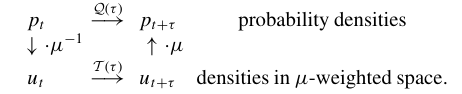
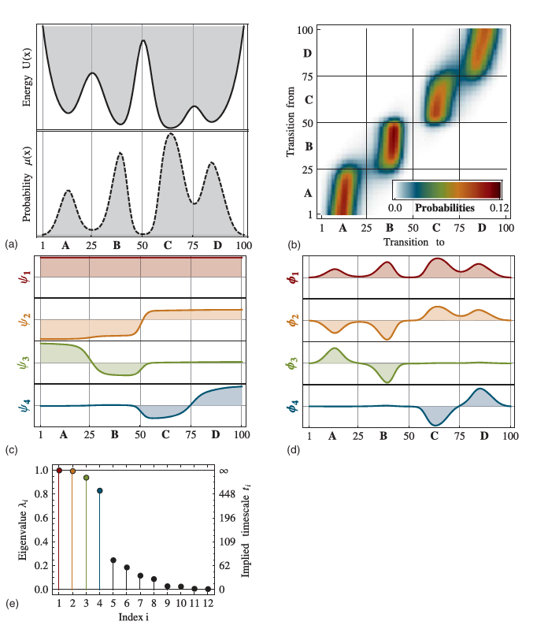
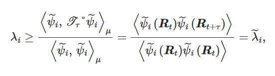
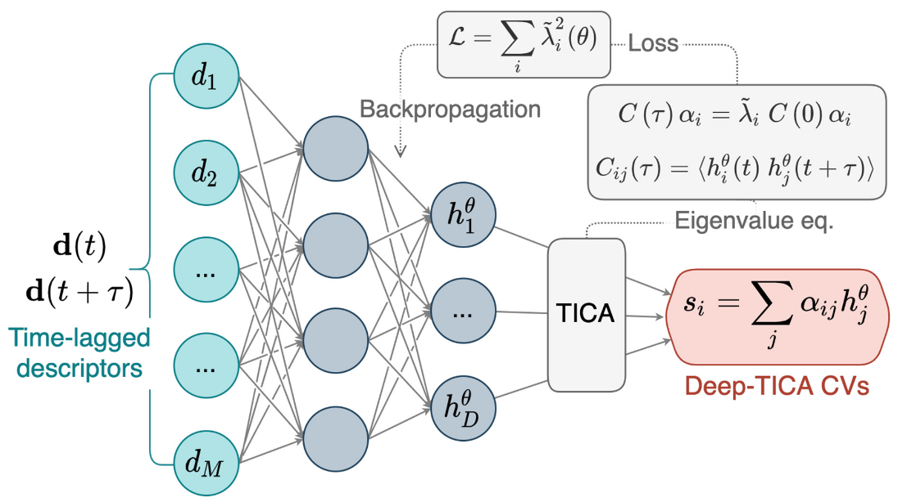

# research-related

## MACE: Higher Order Equivariant Message Passing Neural Networks for Fast and Accurate Force Fields

> [Ilyes Batatia](https://arxiv.org/search/stat?searchtype=author&query=Batatia,+I), [Dávid Péter Kovács](https://arxiv.org/search/stat?searchtype=author&query=Kovács,+D+P), [Gregor N. C. Simm](https://arxiv.org/search/stat?searchtype=author&query=Simm,+G+N+C), [Christoph Ortner](https://arxiv.org/search/stat?searchtype=author&query=Ortner,+C), [Gábor Csányi](https://arxiv.org/search/stat?searchtype=author&query=Csányi,+G)
>
> > Creating fast and accurate force fields is a long-standing challenge in computational chemistry and materials science. Recently, several equivariant message passing neural networks (MPNNs) have been shown to outperform models built using other approaches in terms of accuracy. However, most MPNNs suffer from high computational cost and poor scalability. We propose that these limitations arise because MPNNs only pass two-body messages leading to a direct relationship between the number of layers and the expressivity of the network. In this work, we introduce MACE, a new equivariant MPNN model that uses higher body order messages. In particular, we show that using four-body messages reduces the required number of message passing iterations to just two, resulting in a fast and highly parallelizable model, reaching or exceeding state-of-the-art accuracy on the rMD17, 3BPA, and AcAc benchmark tasks. We also demonstrate that using higher order messages leads to an improved steepness of the learning curves.
>
> | Comments: | Advances in Neural Information Processing Systems, 2022      |
> | --------- | ------------------------------------------------------------ |
> | Subjects: | **Machine Learning (stat.ML)**; Materials Science (cond-mat.mtrl-sci); Machine Learning (cs.LG); Chemical Physics (physics.chem-ph) |
> | Cite as:  | **[arXiv:2206.07697](https://arxiv.org/abs/2206.07697) [stat.ML]** |

核心目的是怎么把旋转矩阵放到MPNN里表示。这里假设第 $t$ 层节点状态未
$$
\sigma_i^{( t )} = ( r_i,z_i,h_i^{( t )} )
$$
这里 $h_i^{( t )}$ 是一个抽象的学习特征。之后先池化，利用神秘消息函数
$$
m_i^{( t )} = \bigoplus M_t( \sigma_i^{( t )},\sigma_j^{( t )} )
$$
然后进行消息传递，用神秘更新函数
$$
h_i^{( t+1 )} = U_t( \sigma_i^{( t )},m_i^{( t )} )
$$
最后用读出函数读出位点能量
$$
E_t= \sum_{t = 1}^{T} R_t( \sigma_i^{( t )} )
$$
现在开始等变部分。我们知道旋转矩阵放到三维里是显然的，但是高维的特征怎么办呢。假设某一个特征的维度是 $2L+1$ 。所以我们希望作用旋转 $Q$ 后的整体
$$
h_{i,L}^{( t )}( Q\cdot ( r_{1},\cdots ,r_{N} ) )
$$
和其他分量加起来的行为相等
$$
\sum_{M'} D^L_{M,M'}( Q )h_{i,kLM'}^{( t )}( r_{1},\cdots ,r_N )
$$
其实就是Wignar矩阵，但是我忘光了。我去补习一下。

---

MACE架构的核心就是多次分级展开。说实话这不就是类似团簇展开吗……
$$
m_i^{( t )} = \sum_j u_{1}( \sigma_i,\sigma_j ) + \sum_{j_{1},j_{2}}u_{2}( \sigma_i, \sigma_{ j_{1} }, \sigma_{ j_{2} } ) + \sum_{j_{1},\cdots ,j_{\nu}}u_{\nu}( \cdots  )
$$
这个神秘 $u$ 函数也是他娘的可以直接学习的量，$\nu$ 是神秘超参数

没救了，后面很多QM东西。等我学会了再来补充

---

## Performing Path Integral Molecular Dynamics Using an Artificial Intelligence-Enhanced Molecular Simulation Framework

> Cheng Fan, Maodong Li, Sihao Yuan, Zhaoxin Xie, Dechin Chen, Yi Isaac Yang, Yi Qin Gao; Performing Path Integral Molecular Dynamics Using an Artificial Intelligence-Enhanced Molecular Simulation Framework. **J. Chem. Theory Comput.** 12 August 2025; 21 (15): 7279–7289. https://doi.org/10.1021/acs.jctc.5c00666

我没写路径积分的专门理论，就先放这里了。假设有N个原子，每个原子用P个bead分解，最后配分函数
$$
Z = \lim_{ P \to \infty } \int\dd[NP]{re^{ -\beta \hat{H}_{eff} }}
$$
其中有效哈密顿量可以拆成两部分
$$
\hat{H}_P = \sum_{i = 1}^{N} \sum_{k = 1}^{P} \qty[ \frac{ p_i^{( k )2} }{ 2m_i } + \frac{1}{2} m_i \omega_P^{2}( r_i^{k+1}  - r_i^{( k )})^{2} ]
$$

---

## Markov models of molecular kinetics: Generation and validation

> Jan-Hendrik Prinz, Hao Wu, Marco Sarich, Bettina Keller, Martin Senne, Martin Held, John D. Chodera, Christof Schütte, and Frank Noé Citation: The Journal of Chemical Physics 134, 174105 (2011); doi: 10.1063/1.3565032 View online: https://doi.org/10.1063/1.3565032 View Table of Contents: http://aip.scitation.org/toc/jcp/134/17 Published by the American Institute of Physics

最近在研究CV相关的问题，我把一系列文献都先放在这里了。

分子动力学可以看作是一个Markov过程，可以定义转移概率
$$
P( x,y;\tau )\dd{y} = P[ x( t+\tau )\in ( y+\dd{y}  )| x( t ) = x ]
$$
 体系唯一稳态
$$
\mu( x ) = Z^{-1} e^{ -\beta H( x ) }
$$
detailed balance
$$
\mu( x )P( x,y;\tau ) = \mu( y )P( y,x;\tau )
$$
传播子propagator
$$
p_{t+\tau}( y ) = Q( \tau ) p_t( y ) = \int_{x \in \Omega} \dd{x} P( x,y;t )p_t( x )
$$
状态转移算符 transfer operator
$$
u_{t+\tau}( y ) = T( t ) u_t( y ) = \frac{1}{\mu( y )}\int_{x \in \Omega}\dd{x} P( x,y;\tau ) \mu( x )u_t( x )
$$
which $u_t( x )$ 相当于是偏离的平衡状态多少。
$$
p_t( x ) = \mu( x ) u_t( x )
$$

可以定义两者的eigenfunction分别为 $\psi$ 和 $\phi$，eigenvalue为 $\lambda$。有
$$
\phi_i( x ) = \mu( x )\psi_i( x )
$$

第一个eigenfunction一定是有最大模的静态操作，因此一定有
$$
\lambda_{0}=1\qc \psi_{0}( x ) = 1
$$
其他特征值
$$
1=\lambda_{0}\geq \lambda_{1}\geq \lambda_{2}\geq \lambda_{3}\geq\cdots
$$

---

最神秘的部分：当作用传播算子 $k$ 次
$$
u_{t+k \tau} = T_\text{ slow }( k \tau )u_t( x ) + T_\text{ fast }( k \tau )u_t( x )
$$
可以看到当指标增加的话，应该对应变换越来越快。于是只统计前$m$个指标
$$
u_{t+k \tau} = \sum_{i = 1}^{m} \lambda_i^k\ip{ u_t }{ \psi_i }_\mu \psi_i( x ) + T_\text{ fast }( k \tau )u_t( x )
$$
按照类似弛豫的形式，可以定义implied timescale
$$
t_i = -\frac{\tau}{\ln \lambda_i}
$$

---

## Deep learning the slow modes for rare events sampling

> [Luigi Bonati](https://www.pnas.org/doi/full/10.1073/pnas.2113533118#con1) https://orcid.org/0000-0002-9118-6239 [luigi.bonati@iit.it](mailto:luigi.bonati@iit.it?cc=michele.parrinello@iit.it), [GiovanniMaria Piccini](https://www.pnas.org/doi/full/10.1073/pnas.2113533118#con2), and [Michele Parrinello](https://www.pnas.org/doi/full/10.1073/pnas.2113533118#con3) [luigi.bonati@iit.it](mailto:luigi.bonati@iit.it?cc=michele.parrinello@iit.it)[Authors Info & Affiliations](https://www.pnas.org/doi/full/10.1073/pnas.2113533118#tab-contributors)
> Luigi Bonati https://orcid.org/0000-0002-9118-6239 luigi.bonati@iit.it，GiovanniMaria Piccini，以及 Michele Parrinello luigi.bonati@iit.it 作者信息与单位
>
> Contributed by Michele Parrinello, September 16, 2021 (sent for review July 22, 2021; reviewed by Modesto Orozco and Rodolphe Vuilleumier)
> 由 Michele Parrinello 投稿，2021 年 9 月 16 日（2021 年 7 月 22 日送审；由 Modesto Orozco 和 Rodolphe Vuilleumier 审阅）
>
> **October 27, 2021 2021 年 10 月 27 日**
>
> 118 (44) e2113533118
>
> https://doi.org/10.1073/pnas.2113533118

可以借鉴变分法的思路求解传播子特征值

这里试探函数取N个描述符(（键长，键角等？）线性组合
$$
\tilde{\psi}_i( R ) = \sum_{j = 1}^{N_d} \alpha_{ij}d_{j}( R )
$$
变分参数是 $\alpha_{ij}$。然后就是求解本征值问题了。
$$
C_{ij}( \tau )\alpha_{ij} = \tilde{\lambda}_{ij}C_{ij}( 0 )\alpha_{ij}
$$
这里相关函数
$$
C_{ij}( \tau ) = \ev{ d_i( R_t )d_j( R_{t+\tau} ) }
$$
这个是TICA。如果用神经网络形式就是Deep-tica

之后梯度下降函数
$$
L = -\sum_{i = 1}^{D} \tilde{\lambda}^{2}_{i}( \theta )
$$

增强采样有一个问题，就是他施加了一个外部势。如果要恢复到原来的期望值就要乘以个权重
$$
\ev{ O( R ) } = \frac{ \ev{ O( R )e^{ \beta V } }_V }{ \ev{  e^{ \beta V }}_V }
$$
但是这是静态量。如果要做时间相关的量要做方所，进行替换使得
$$
\dd{t'} = e^{ \beta V }\dd{t} 
$$
然后做时间平均
$$
\ev{ O( R ) } = \frac{ \int_{0}^{T} O( R_t )  \dd{t'}  }{ \int_{0}^{T}  \dd{t'}  }
$$
作者这里偏置势用的是OPES。之后直接把 $t'$ 带入到前面的
$$
C_{ij}( \tau ) = \ev{ d_i( R( t' ) )d_j( R( t'+\tau ) ) }
$$
后面的
