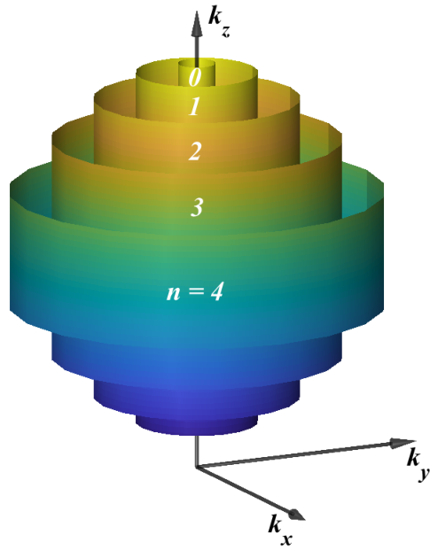

# 量子统计物理

## 1. density matrix

对于混合态的作用算符 $\hat{F}$ ，理论上计算期望得到：

$$
\ev{ \hat{F} } = \sum_i \mel{ \Psi ^i( t ) }{ \hat{F} }{ \Psi ^i( t ) }p_i
$$

插入投影算符

$$
\ev{ \hat{F}} = \sum_i\sum_n\sum_m \ip{ \Psi ^i( t ) }{ \psi _n }\mel{ \psi _n }{ \hat{F} }{ \psi _m }\ip{ \psi _m }{ \Psi ^i( t ) }p_i
$$

定义矩阵元

$$
F_{nm} = \mel{ \psi _n }{ \hat{F} }{ \psi _m }
$$

得到期望值

$$
\ev{ \hat{F} } = \sum_{i, n, m} F_{nm}\ip{ \psi _m }{ \Psi ^i( t ) }\ip{ \Psi ^i( t ) }{ \psi _n }p_i
$$

我们定义密度矩阵：

$$
\hat{ \rho  } = \sum_i \op{ \Psi ^i( t ) } p_i
$$

于是混合态期望可表示为：

$$
\ev{ \hat{F} } = \sum_{n, m}F_{nm}\rho _{nm} = \Tr( \hat{ \rho  }\hat{F} )
$$

后面的事情在基础量子就学过：

$$
\Tr( \hat{ \rho  } ) = 1\qc \hat{ \rho  }^{\dagger} = \hat{ \rho  }\qc \Tr( \hat{ \rho  }^{2} ) \leq  1
$$

只有纯态是等号成立。作为一个例子，对于

$$
\ket{\Psi ^i} = \cos\alpha_i \ket{\psi _x} + \sin\alpha_i \ket{\psi _y}
$$

对应密度矩阵

$$
\hat{ \rho  } = \sum_i p_i \pmqty{
\cos ^{2}\alpha_i & \cos\alpha_i \sin\alpha_i \\
\cos\alpha_i \sin\alpha_i & \sin ^{2} \alpha_i
}
$$

含时 Schrodinger 方程给出

$$
i\hbar \pdv{ t } \ket{\Psi ^i( t )}  = \hat{ H } \ket{\Psi ^i( t )}
$$

对密度算符求导：

$$
\begin{align}
i\hbar \pdv{ t  } \hat{ \rho  }  & = \sum_i p_i \qty [ \qty( i\hbar \pdv{ t } \ket{\Psi ^i( t )} \bra{\Psi ^i( t )}  + \ket{\Psi ^i( t )}i\hbar \pdv{ t }\bra {\Psi ^i( t )} ) ] \\
 & = \sum_i p_i \qty [ \hat{H}\op{ \Psi ^i( t ) } - \op{ \Psi ^i( t ) }\hat{H} ] \\
 & = \comm{ \hat{H} }{ \hat{ \rho  } }
\end{align}
$$

这是 Liouville 方程。

---

## 2. ensemble

### 2.1 Classical Statistic

相空间的哈密顿量：

$$
\dot{q_i} = \pdv{ H( q, p ) }{ p_i } \qc \dot{p_i} = -\pdv{ H( q, p ) }{ q_i }
$$

固定能量

$$
    \sum_{i = 1}^{3N} \frac{p_i^{2}}{2m}= E
$$

于是对应密度函数

$$
\rho ( p, q ) = \begin{cases}
const.  & E\leq H( p, q )\leq E+\Delta E \\
0 & else.
\end{cases}
$$

这意味着密度函数就是这样一个微小相空间的体积倒数。

### 2.2 Microcanonical ensemble

consider in QM, one can define

$$
p_i = \begin{cases}
\Gamma ^{-1}( E, N, V ) & E\leq E_i\leq E+\Delta E \\
0  & else
\end{cases}
$$

where $\Gamma$ means the phase space volume of a shallow curve between $E$ and $E+\Delta E$.

define a func

$$
\Delta x = \begin{cases}
1 & 0\leq x\leq \Delta E \\
0 & else
\end{cases}
$$

do transform

$$
\begin{align}
\hat{ \rho  } &  = \sum_i p_i\op{ \psi _i }{ \psi _i } \\
 & = \sum_i \Gamma ^{-1}( E, N, V )\Delta( E_i-E )\op{ \psi _i }{ \psi _i } \\
 & = \Gamma ^{-1}( E, N, V ) \sum_i\Delta( \hat{H}-E )\op{ \psi _i }{ \psi _i } \\
 & = \Gamma ^{-1}( E, N, V ) \Delta( \hat{H}-E )

\end{align}
$$

我们考虑其对数期望

$$
\begin{align}
\ev{ \ln \rho  }  & = \Tr( \rho \ln \rho  ) \\
 & = \sum_{m, n}\rho _{mn}( \ln \rho_{mn} )
\end{align}
$$

选定

$$
\rho _{mn} = \mel{ \psi _m }{ \sum_i p_i }{ \psi _i }\ip{ \psi _i }{ \psi _n } = p_n\delta_{m, n}
$$

因此矩阵为对角，同样 $\ln \rho$ 也对角。于是有：

$$
\begin{align}
\ev{ \ln \rho  }
 & = \sum_{m, n}p_n( \ln p_n ) \delta_{m, n} \\
 & = \sum_{n}p_n( \ln p_n ) = -\ln\Gamma
\end{align}
$$

于是可以定义熵，它和态的总数正相关

$$
S = -k_B \ev{ \ln \rho  } = k_B \ln\Gamma
$$

接下来计算哈密顿量

$$
\begin{align}
\ev{ \hat{H} }=\Tr( \rho H ) & =\Gamma ^{-1}\Tr( H\Delta( \hat{H}-E )) \\
 & = \Gamma ^{-1} \sum_{m, n}H_{m, n}( \Delta( H-E ) )_{n, m}
\end{align}
$$

and

$$
\begin{align}
\ev{ H } &  = \Gamma ^{-1} \sum_{m, n}H_{m, n}( \Delta( H-E ) )_{n, m} \\ \\
 & = \Gamma ^{-1} \sum_{m, n}\mel{ \psi _n }{ H }{ \psi _m }\mel{ \psi _m }{( \Delta( H-E ) )_{m, n}}{ \psi _n } \\
 & = \Gamma ^{-1} \sum_n E_n\Delta( E_n - E )  \\
 & = E \sum_np_n = E
\end{align}
$$

we found the eqn is self-consisted.

---

as definition, the equilibrium state def as when

$$
S = S_{max}
$$

我们假设有两个体系，分别为 A 和 A‘。外部能量分别为 E 和 E‘。有

$$
E+E'= E^{( 0 )}
$$

假定这两个体系之间可以互相传递能量。对于相空间

$$
\Gamma^{( 0 )}( E, E' ) = \Gamma( E )\Gamma'( E^{( 0 )}-E )
$$

当熵最大时，一定有：

$$
\pdv{ \Gamma^{( 0 )}( E, E' ) }{ E } = 0
$$

也就是：

$$
\pdv{ \Gamma( E ) }{ E } \cdot \Gamma'( E' ) = \pdv{ \Gamma'( E' ) }{ E' } \cdot \Gamma( E )
$$

we got

$$
\pdv{ E } \ln\Gamma( E ) = \pdv{ E' } \ln\Gamma'( E' ) = \frac{1}{k_{B}T}
$$

带入到熵的定义得到

$$
\qty(\pdv{ S }{ E })_{ N, V } = \frac{1}{T}
$$

现在，我们假设系统的体积同样也会发生变化。很容易得到相同的等式：

$$
\begin{gathered}
\pdv{ E } \ln\Gamma( E ) = \pdv{ E' } \ln\Gamma'( E' ) = \frac{p}{k_{B}T} \implies  \qty(\pdv{ S }{ V })_{ E, V } = \frac{p}{T} \\
\cdots
\end{gathered}
$$

于是得到基本方程：

$$
\dd{S} = \frac{1}{T}\dd{E} +\frac{p}{T}\dd{V} -\frac{\mu}{T}\dd{N}  
$$

---

### 2.3 Canonical Ensemble

前面我们已知

$$
p_i = \frac{1}{Z} e^{ -\beta E_i }
$$

c 插入到密度矩阵表达式：

$$
\begin{align}
\hat{ \rho  }  & = \sum_i \op{ \psi _i } \\
 & = \frac{1}{Z} \sum_i e^{ -\beta E_i }\op{ \psi _i } \\
 & =  \frac{1}{Z} \sum_i e^{ -\beta \hat{ H } }\op{ \psi _i } \\
 & = \frac{1}{Z}e^{ -\beta \hat{ H } }
\end{align}
$$

这可以导出经典热力学的很多等式：

$$
E = -\pdv{   }{ \beta } \ln Z \qc F = -k_{B}T\ln Z
$$

还有一个特征的熵等式：

$$
\begin{align}
-k_B \Tr( \hat{ \rho  }\ln \hat{ \rho  } )  & = -k_B\sum_i p_i\ln p_i \\
 & = \cdots  \\
 & = \frac{E}{T} - \frac{F}{T} \\
 & = S
\end{align}
$$

这于是可以导出热力学第三定律，也就是 0K 下只有基态

$$
p_0 = 1
$$

导致系统变为纯态。此时 $S=0$ .

---

和经典统计类似，也可以换成按能量的统计。定义态密度

$$
g( E ) = \dv{ \Gamma( E ) }{ E }
$$

通过积分计算

$$
Z = \int_{0}^{\infty} e^{ -\beta E }g( E ) \dd{E}\qc \ev{ f } = \frac{1}{Z} \int_{0}^{\infty} f( E )e^{ -\beta E }g( E ) \dd{E}
$$

举例：对于有 $N$ 个量子谐振子形成的系统

$$
\hat{H} = \sum_i \frac{\hbar ^{2}}{2m}\dv [2]{   }{ x } + \frac{1}{2}m\omega ^{2}x^{2}
$$

由于每个谐振子都是独立的，我们可以把它拆成独立的哈密顿量

$$
h =\frac{\hbar ^{2}}{2m}\dv [2]{   }{ x } + \frac{1}{2}m\omega ^{2}x^{2}
$$

于是就可以拆开能量和波函数

$$
E = \sum_{i = 1}^{N} \varepsilon_i \qc \Psi ( x_1,\cdots , x_N ) = \prod_{i = 1}^{N} \psi _i( x_i )
$$

从经典统计里面，我们拿到公式（这里还没证明）：

$$
Z = z^N\qc z =\sum_{i = 1}^{N} e^{ -\beta\varepsilon_i }
$$

然后得到。。。

---

### 2.4 Grand Canonical

现在我们考虑一个能量和粒子都会交换的体系，此时需要新增一个交换约束

$$
N + N' = N^{( 0 )}
$$

根据同样的方法可以得到

$$
\pdv{ N } \ln\Gamma( N ) = \pdv{ N' } \ln\Gamma'( N' ) = -\frac{\mu}{k_{B}T}
$$

同样假设外部粒子库的态密度是极高的，因此理论有：

$$
\frac{E}{E^{( 0 )}} = 1- \frac{E'}{E^{( 0 )}} \ll 1\qc \frac{N}{N^{( 0 )}} = 1- \frac{N'}{N^{( 0 )}} \ll 1
$$

对 $\ln \Gamma$ 展开：

$$
\begin{align}
\ln \Gamma' &  = \ln\Gamma'( E^{( 0 )}, N^{( 0 )} ) + \pdv{ \ln\Gamma' }{ E' } \cdot E + \pdv{ \ln\Gamma' }{ N' } \cdot N \\
 & = const. + \frac{\mu}{k_{B}T}N - \frac{1}{k_{B}T}E_i
\end{align}
$$

由此定义

$$
p_i = e^{ -\beta( E_i - \mu N ) }
$$

得到巨配分函数：

$$
\Xi = \sum_{N, i} e^{ -\beta( E_i - \mu N ) }
$$

用量子力学的语言表示：

$$
p_i = e^{ -\beta( \hat{H} - \mu \hat{N} ) }\qc \Xi = \Tr( e^{  -\beta( \hat{H} - \mu \hat{N})} )
$$

密度矩阵

$$
\hat{ \rho  } = \Xi ^{-1}e^{ -\beta( \hat{H} - \mu \hat{N} ) }
$$

计算离子数

$$
\begin{align}
\Tr( \hat{ \rho  }\hat{N} ) & = \sum_{m, n}\rho _{mn}N_{nm} \\
 & = \sum_{N, i}\sum_{N', i'}\rho _{Ni, N'i'}N_{Ni, N'i'} \\
 & = \sum_{N, i} \rho _{Ni, Ni}N
\end{align}
$$

又有对于对应的密度矩阵元

$$
\rho _{Ni, Ni} = \Xi^{-1} e^{ -\beta( E_i-\mu N ) }
$$

对应的

$$
\ev{ N } = \Xi^{-1}\sum_{N = 0}^{\infty}Ne^{ -\beta( E_i-\mu N ) }
$$

也就是

$$
\ev{ N } = -\pdv{   }{ \alpha } \ln\Xi
$$

对于能量：

。。。

另一种通过逸度的定义

$$
\Xi = \sum_{N = 0}^{\infty} z^{N}Z( N, V, T )\qc z = e^{ \beta \mu  }
$$

之后的大部分推理方法与经典类似，不再赘述。有一个不同的是熵的推导

$$
\begin{align}
S  & = \cdots
\end{align}
$$

考虑一个由 $N$ 个能级 $\{n_{1},n_{2},\cdots ,n_N\}$ 组成的巨正则系综，其中个能级的粒子数可能出现 $0 \sim  \infty$ 个

$$
\begin{align}
Z & = \sum_{n_{1} = 0}^{\infty} \sum_{n_{2} = 0}^{\infty} \cdots  \sum_{n_N = 0}^{\infty} e^{ -\beta\sum_{l = 1}^{N} \varepsilon_l } \\
 & = \sum_{n_{1},n_{2},\cdots ,n_N}\prod_{l = 1}^{N} e^{ -\beta\varepsilon_l } \\
 & = \prod_{l = 1}^{N} \sum_{n_l = 0}^{\infty} e^{ -\beta \varepsilon_l }
\end{align}
$$

---

## 3. Quantum Gases

### ideal quantum gas

对 $\infty$ 个能级分布的 $N$ 个粒子数采取粒子数表象

$$
\ket{n_{1},n_{2},\cdots ,n_\infty} = \ket{N,i}
$$

这里的 $i$ 指的是一种抽象的 $N$ 粒子排布方式。考虑巨正则配分函数

$$
\begin{align}
\Xi  & = \Tr( e^{ -\beta( \hat{H}-\mu \hat{N} ) } ) \\
 & = \sum_{N = 0}^{\infty} \sum_i \mel{ N,i }{ e^{ -\beta( \hat{H}-\mu \hat{N} ) } }{ N,i } \\
 & = \sum_{n_{1} = 0}^{\infty} \sum_{n_{2} = 0}^{\infty} \cdots  \sum_{n_\infty = 0}^{\infty} \mel{ N,i }{ e^{ -\beta( \hat{H}-\mu \hat{N} ) } }{ N,i }
\end{align}
$$

展开算子

$$
\begin{align}
\Xi  & = \sum_{n_{1},n_{2},\cdots ,n_\infty} \mel{ N,i }{ \exp( \sum_i \varepsilon_in_i - \mu \sum_i n_i) }{ N,i } \\
 & = \prod_{i = 1}^{\infty} \sum_{n_i}\exp( -\beta( \varepsilon_i -\mu)n_i )
\end{align}
$$

---

Bosons

$$
\Psi(\cdots ,x_{i}, \cdots ,x_{j},\cdots ) = \Psi(\cdots ,x_{j}, \cdots ,x_{i},\cdots )
$$

Fermions

$$
\Psi(\cdots ,x_{i}, \cdots ,x_{j},\cdots ) = ( - )\Psi(\cdots ,x_{j}, \cdots ,x_{i},\cdots )
$$

因此我们不能直接拆波函数，必须拆成对称性轮换形式。利用置换算子 $P$ 统计所有交换粒子位置之后的波函数城际

Boson

$$
\Psi_n( x_{1},\cdots ,x_{N} ) = \frac{1}{ \sqrt{ N!  }} \sum_P P[  \varphi_{n_{1}}( x_{1} )\cdots \varphi_{n_N}( x_N ) ]
$$

Fermions

$$
\Psi_n( x_{1},\cdots ,x_{N} ) =\frac{1}{ \sqrt{ N!  }} \sum_P ( - )^{A_P} P[ \varphi_{n_{1}}( x_{1} )\cdots \varphi_{n_N}( x_N ) ]
$$

对于 Fermion，还可以用Slater行列式来定义，因为行列式交换行会导致符号反转

$$
\Psi_n( x_{1},\cdots ,x_{N} ) = \frac{1}{ \sqrt{ N!  }} \mdet{
\varphi_{n_{1}}( x_{1} ) & \varphi_{n_{1}}( x_{2} ) & \cdots  & \varphi_{n_1}( x_N ) \\
\vdots  & \vdots  & \ddots  & \vdots  \\
\varphi_{n_{N}}( x_{1} ) & \varphi_{n_{N}}( x_{2} ) & \cdots  & \varphi_{n_N}( x_N )
}
$$

当存在两行相同时，则行列式变为0. 这就对应Pauli不相容原理

$$
n_i \neq  n_j
$$

---

之后量子统计方法和经典相同··

---

晶格中的统计见固体物理

---

### ideal usal bose gas

total particle number
$$
\begin{align}
N & = \sum_i \frac{1}{e^{ \beta( \varepsilon_i-\mu ) }-1} \\
 & =g \sum_{\va{k}} \frac{1}{e^{ \beta( \varepsilon-\mu ) }-1} \\
 & = g \frac{V}{( 2\pi )^{3}} \cdot 4\pi \int_{0}^{\infty}  \dd{k} k^{2} \frac{1}{e^{ \beta( \varepsilon-\mu ) }-1}  \\
 & = \frac{gV}{4\pi^{2}} \qty( \frac{2m}{\hbar^{2}} )^{3/2 } \int_{0}^{\infty}  \dd{\varepsilon} \frac{ \varepsilon^{1/2 } }{ e^{ \beta( \varepsilon-\mu ) }-1 }
\end{align}
$$
对应能量
$$
E = \frac{gV}{4\pi^{2}} \qty( \frac{2m}{\hbar^{2}} )^{3/2 } \int_{0}^{\infty}  \dd{\varepsilon} \frac{ \varepsilon^{3/2 } }{ e^{ \beta( \varepsilon-\mu ) }-1 }
$$
grand potential
$$
\begin{align}
\Omega &  = \beta ^{-1} \sum_{i = 1}^{\infty} \ln( 1-e^{ \beta( \mu-\varepsilon ) } ) \\
 & = \beta ^{-1} \frac{gV}{4\pi^{2}} \qty( \frac{2m}{\hbar^{2}} )^{3/2 } \int_{0}^{\infty}  \dd{ \varepsilon}\varepsilon^{1/2 } \ln( 1-e^{ \beta( \mu-\varepsilon ) } )  \\
 & =  \frac{gV}{4\pi^{2}} \qty( \frac{2m}{\hbar^{2}} )^{3/2 } \frac{3}{2} \int_{0}^{\infty}  \dd{\varepsilon} \frac{ \varepsilon^{3/2 } }{ e^{ \beta( \varepsilon-\mu ) }-1 }
\end{align}
$$

---

###  ideal fermion

呃就是改一下
$$
\begin{gathered}
N = \frac{gV}{4\pi^{2}} \qty( \frac{2m}{\hbar^{2}} )^{3/2 } \int_{0}^{\infty}  \dd{\varepsilon} \frac{ \varepsilon^{1/2 } }{ e^{ \beta( \varepsilon-\mu ) }-1 } \\
E = \frac{gV}{4\pi^{2}} \qty( \frac{2m}{\hbar^{2}} )^{3/2 } \int_{0}^{\infty}  \dd{\varepsilon} \frac{ \varepsilon^{3/2 } }{ e^{ \beta( \varepsilon-\mu ) }-1 } \\
\Omega = -\frac{2}{3} E
\end{gathered}
$$
fermi distribution on T=0
$$
\frac{1}{e^{ \beta( \varepsilon-\mu ) }+1} = H( \mu-\varepsilon )
$$
Summerfeld expansion
$$
\begin{align}
\int_{0}^{\infty}  \dd{\varepsilon} \frac{ \varepsilon^{3/2 } }{ e^{ \beta( \varepsilon-\mu ) }-1 } &  = \int_{0}^{\mu}  \dd{\varepsilon} \varepsilon^{3/2 } + \frac{\pi^{2}}{6} ( k_{B}T )^{2} \frac{3}{2}\cdot \mu^{1/2} + \cdots \\
 & = \frac{2}{5}\mu^{5/2} + \frac{\pi^{2}}{4} ( k_{B}T )^{2} \mu^{1/2} + \cdots 
\end{align}
$$
particle num
$$
N = \frac{gV}{4\pi^{2}} \qty( \frac{2m}{\hbar^{2}} )^{3/2 }  \qty[ \frac{2}{3}\mu^{3/2} + \frac{\pi^{2}}{8} \mu^{-1/2} ]
$$
in T=0 we have
$$
N =  \frac{gV}{4\pi^{2}} \qty( \frac{2m}{\hbar^{2}} )^{3/2 }  \frac{2}{3}\varepsilon_{F}^{3/2}
$$
solv
$$
\mu = \varepsilon_{F}\qty[ 1-\frac{\pi^{2}}{12} \qty( \frac{k_{B}T}{\varepsilon_{F}} )^{2} ]
$$

---

def magnitization
$$
M = -\qty(\pdv{ \Omega }{ B })_{ T,V,\mu } 
$$
后面可以证明
$$
M = \mu ^{*}( N^+ - N^- )
$$
suspectivity
$$
\chi( B ) = \frac{1}{V} \pdv{ M }{ B } 
$$
假设对自旋1/2体系，定义能量
$$
\varepsilon = \frac{p^{2}}{2m} - \va{\mu}\cdot \va{B}
$$
on T=0
$$
N = N_+ + N_-
$$

$$
\frac{ \hbar^{2}k_{+}^{2} }{ 2m } - \mu ^{*}B = \frac{ \hbar^{2}k_{-}^{2} }{ 2m } + \mu ^{*}B = \mu
$$
for example
$$
k_+ = \qty[ \frac{2m}{\hbar^{2}}( \mu+\mu ^{*}B ) ]^{1/2}
$$

$$
\begin{align}
N_+ = \frac{ Vk_{+}^{3} }{ 6\pi^{2} }
\end{align} = \frac{1}{6\pi^{2}} \qty[ \frac{2m}{\hbar^{2}}( \mu+\mu ^{*}B ) ]^{1/2}
$$

magnetization
$$
M = \mu ^{*}( N_{+} - N_- ) = \frac{ \mu ^{*}V( 2m )^{3/2} }{6\pi^{2}\hbar^{3}  }\qty[ ( \mu+\mu ^{*}B )^{3/2 } - ( \mu+\mu ^{*}B )^{3/2 } ]
$$
计算得到
$$
\chi = \lim_{ B \to 0 } \frac{M}{VB} =  \frac{ \mu ^{*^2}( 2m )^{3/2 } \varepsilon_F^{1/2} }{ 6\pi^{2}\hbar^{3} }
$$
for arbitrary T
$$
\begin{align}
\Xi  & = \Tr\exp[ -\beta( H-\mu N ) ] \\
 & =\sum_i \ev{ \exp[ -\beta( \hat{H}-\mu \hat{N} ) ] }{ i } \\
 & = \sum_{n_{1\uparrow},\cdots ,n_{n\downarrow}} \exp( -\beta( \sum_{\sigma}\sum_i  \varepsilon_{i\sigma}n_{i\sigma} - \mu \sum_{\sigma}\sum_i n_{i\sigma}) ) \\
 & = \prod_{i = 1}^{\infty} \qty[ ( 1+e^{ \beta( \mu-\varepsilon_{j\uparrow} ) } )( 1+e^{ \beta( \mu-\varepsilon_{j\downarrow} ) } ) ]
\end{align}
$$
we have
$$
\ln \Xi  =\frac{1}{2}\ln \Xi_{0}( \mu+\mu ^{*}B ) + \frac{1}{2}\ln \Xi_{0}( \mu-\mu ^{*}B )
$$
obivous
$$
\Omega = \frac{1}{2}\Omega_{0}( \mu+\mu ^{*}B ) + \frac{1}{2}\Omega_0 ( \mu-\mu ^{*}B )
$$
derivative by B we can prove that
$$
M = \mu ^{*}( N^+ - N^- )
$$
we can also prove
$$
N_{\uparrow} - N_{\downarrow} = \mu ^{*} B\qty(\pdv{ N }{ \mu })_{ T,V }
$$
do taylor expansion around $\Omega_{0}( \mu )$
$$
\Omega_{0}( \mu ^{*} ) = \Omega_{0}( \mu ) + \pdv{ \Omega_{0}( \mu ) }{ \mu } \mu ^{*}B + \frac{1}{2}\pdv[2]{ \Omega_{0}( \mu ) }{ \mu } \qty( \mu^{*}B )^{2}
$$
得到
$$
\Omega = \Omega_{0}( \mu ) + \frac{1}{2}( \mu ^{*}B )^{2}\pdv[2]{ \Omega_{0}( \mu ) }{ \mu }
$$
得到的磁化率为
$$
M = -\qty(\pdv{ \Omega }{ B })_{ T,V,\mu } = -\mu ^{*^{2}} B \qty(\pdv[ 2 ]{ \Omega_{0}( \mu ) }{ \mu })_{ T,V }  =  -\mu ^{*^{2}} B \qty(\pdv{ N }{ \mu })_{ T,V } 
$$

...

---

### Landau 抗磁性

**Bohr - van Leeuwen Theorem** on classical physics (doesn't consider spin) $M=0$

proof on B=0 we have
$$
H = \sum_{i = 1}^{N} \frac{ p_i^{2} }{ 2m } + V( q_i )
$$
for kinetic Momentum
$$
\tilde{p}_i =  p_i - \frac{ eA( q_i ) }{ c }
$$
on classical stat
$$
\begin{align}
\Xi( V,\mu,T,B )  & = \sum_{N=0}^{\infty} \frac{1}{N!h^{3}} \int\dd[3]{\tilde{p}}\dd[3]{q} e^{ -\beta( H-\mu N ) } \\
 & =  \\
 & = \Xi_{0}
\end{align}
$$
于是 $M=0$ 又有 $\chi= 0$ ，即没有磁性。

in Landau gauge
$$
h=\frac{1}{2m}( p-\frac{ eA }{ c } )^{2} \qc A_x = -By\qc A_y=A_z=0
$$
SE
$$
\qty[ \frac{1}{2m} ( p_x + \frac{ eBy }{ c } )^{2} + \frac{1}{2m} ( p_y^{2} + p_z^{2} ) ]\psi_i( r ) = \varepsilon_i\psi_i( r )
$$
B_z is not a good quant #

on B = 0
$$
\varepsilon( \va{p} ) = \frac{1}{2m} ( p_x^{2} + p_y^{2} ) + \frac{1}{2m} p_z^{2}
$$
on $B\neq 0$
$$
\varepsilon( j,p_z ) = \mu_BB( j+\frac{1}{2} ) + \frac{1}{2m} p_z^{2}
$$

施加磁场会导致电子被固定到固定的能级上。现在统计每两个圆之间的态密度
$$
\begin{align}
g  & = \frac{ V^{2/3} }{ ( 2\pi )^{2} } \pi ( k_{max}^{2} ) \\
 & = \frac{ V^{2/3} 2m }{ 4\pi \hbar^{2} } \cdot  \frac{ \hbar^{2} k_{max}^{2} }{ 2m } \\
 & = \frac{ V^{2/3 }m }{ 2\pi \hbar^{2} }\mu_BB
\end{align}
$$
计算得到配分函数
$$
\begin{align}
\ln \Xi  & = \sum_i \ln( 1+e^{ -\beta( \varepsilon_i-\mu ) } ) \\
 & = g\sum_{j = 0}^{\infty} \sum_{k_z} \ln( 1+e^{ -\beta( \varepsilon_i-\mu ) } ) \\
 & = g \sum_{j = 0}^{\infty} \frac{ V^{1/3 } }{ 2\pi } \int_{-\infty}^{\infty}  \dd{k_z} \ln( 1+\exp( \beta( \mu_BB( j+\frac{1}{2} ) + \frac{\hbar^{2}k_z^{2}}{2m} -\mu) ) )
\end{align}
$$
consider when high T limit $\beta \to  0$, using $\ln( 1+x ) = x$
$$
\ln \Xi = \frac{ gV^{1/3 } }{ 2\pi }e^{ -\beta \mu } \sum_{j = 0}^{\infty} e^{ \beta \mu_B B( j+1/2  ) } \cdot \int_{-\infty}^{\infty} e^{ \hbar^{2}k_z^{2}/2m } \dd{k_z}
$$
obtain
$$
\ln \Xi = \frac{ zVeB }{ h^{2}c } \qty( \frac{ 2\pi m }{ \beta } )^{1/2} \qty( 2\sinh( \frac{ \beta e\hbar B }{ 2mc } ) )^{-1}
$$
on high T limit
$$
\frac{1}{V} \ln \Xi = \frac{z}{\lambda^{3}}\qty[ 1-\frac{1}{6} ( \frac{ e\hbar  }{ 2mc } )^{2}( \frac{B}{k_{B}T} )^{2} ]
$$
then we can easily obtain

...

---

define
$$
F( x ) = \ln( 1+\exp( \beta( \mu_BBx + \frac{\hbar^{2}k_z^{2}}{2m} -\mu) ) )^{-1}
$$
using Eular - Maclaurin Theorem
$$
\frac{1}{2}F( a ) + \sum_{i = 1}^{\infty} F( a+j ) = \int_{a}^{\infty} F( x ) \dd{x}  - \frac{1}{12} F'( a )
$$
let $a=1/2$
$$
\frac{1}{2}F( \frac{1}{2} ) + \sum_{j = 1}^{\infty} F( \frac{1}{2} + j ) = \int_{0}^{\infty} F( x ) \dd{x} - \int_{0}^{1/2 } F( x ) \dd{x}  - \frac{1}{12}F'( \frac{1}{2} )
$$
using
$$
F( x )  =F( 0 ) + xF'( 0 )
$$
finally obtain
$$
\sum_{j = 1}^{\infty} F( j+\frac{1}{2} ) = \int_{0}^{\infty} F( x ) \dd{x} + \frac{1}{24}F'(0x )
$$
